# Modelagem de tarefas (HTA)

Análise hierárquica de tarefas (*Hierarchical Task Analysis*) das tarefas principais do
Obrix, feita sobre o fluxo implementado. Cada tarefa tem o diagrama de decomposição e o
**plano**, que diz em que ordem e em que condições as subtarefas são executadas.

Convenções:

- a numeração segue a HTA clássica (0 → 1, 2… → 1.1, 1.2…);
- **Plano** usa "faça 1-2-3" para sequência, "se… então…" para condição e "até que"
  para repetição;
- as telas e arquivos citados são os do sistema real (`src/main/resources/static/`);
- os diagramas usam Mermaid, que o GitHub renderiza.

As tarefas são executadas pelas personas de [personas.md](personas.md).

---

## Cliente

### 0. Contratar um serviço residencial (visão geral)

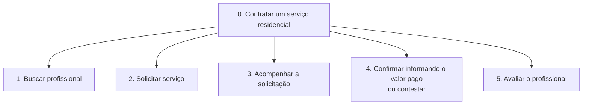

**Plano 0:** faça 1-2-3. Se o profissional recusar (status `RECUSADA`), volte a 1. Quando
o status chegar a `AGUARDANDO_CONFIRMACAO`, faça 4. Se 4 terminar em `CONCLUIDA`, faça 5
(opcional). Se 4 terminar em `CONTESTADA`, espere o profissional registrar a conclusão
de novo e repita 4.

### 1. Buscar profissional

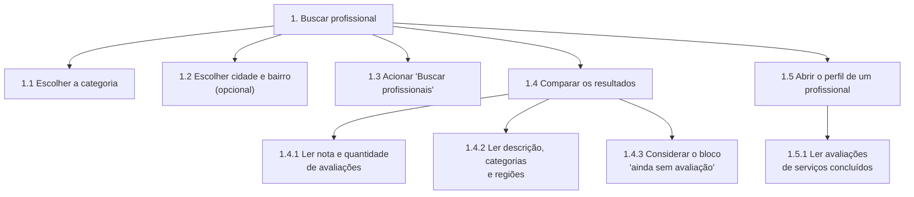

**Plano 1:** faça 1.1. Faça 1.2 se quiser restringir a região. Faça 1.3. Se a categoria
não foi escolhida, o sistema avisa "Escolha uma categoria para buscar." e volta a 1.1.
Faça 1.4 (1.4.1 e 1.4.2 em qualquer ordem; 1.4.3 se houver o bloco separado). Faça 1.5
até encontrar um profissional adequado; se nenhum servir, refaça 1.2 com outros filtros
(tela de resultados, botão "Filtrar").

Telas: `index.html` → `resultados.html` → `perfil.html`. A busca não exige conta.

### 2. Solicitar serviço

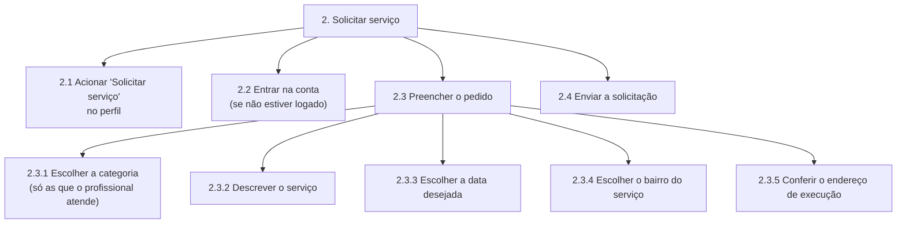

**Plano 2:** faça 2.1. Se não houver sessão, faça 2.2 (o sistema redireciona para
`entrar.html` e volta à solicitação depois do login). Faça 2.3: 2.3.1 a 2.3.4 em
qualquer ordem; 2.3.5 depois de 2.3.4, porque cidade e bairro vêm da região escolhida.
Faça 2.4. Se faltar descrição ou endereço, o sistema marca o campo e volta a 2.3.

Tela: `solicitar.html`, quarta e última etapa do fluxo de contratação.

### 3. Acompanhar a solicitação

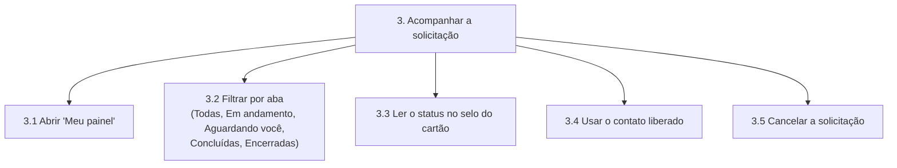

**Plano 3:** faça 3.1-3.2-3.3 sempre que quiser saber o andamento. Se o status for
`ACEITA` ou posterior, 3.4 fica disponível (telefone e e-mail no cartão). Se o status for
`SOLICITADA` ou `ACEITA` e o cliente desistir, faça 3.5 (motivo obrigatório). Repita até
o status chegar a `AGUARDANDO_CONFIRMACAO` ou a um estado final.

Tela: `painel-cliente.html`.

### 4. Confirmar informando o valor pago, ou contestar

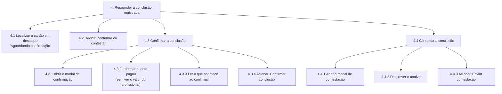

**Plano 4:** faça 4.1-4.2. Se o serviço foi feito como combinado, faça 4.3 (4.3.1-4.3.2-
4.3.3-4.3.4). Se não foi, faça 4.4 (4.4.1-4.4.2-4.4.3). Em 4.3.4:

- se o valor informado for **igual** ao registrado pelo profissional, o status vai para
  `CONCLUIDA` e a comissão é registrada;
- se for **diferente**, o status vai para `CONTESTADA`, sem comissão, e o serviço volta
  ao profissional.

Se o cliente não fizer nada em 7 dias, o sistema confirma sozinho (confirmação
automática), exceto se a solicitação já tiver sido contestada alguma vez.

Tela: `painel-cliente.html`, modais "Confirmar a conclusão do serviço" e "Contestar a
conclusão".

### 5. Avaliar o profissional

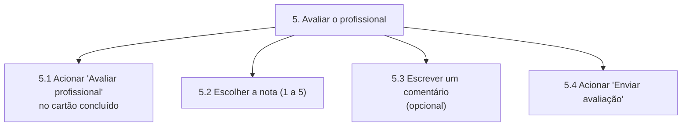

**Plano 5:** só disponível em `CONCLUIDA` e uma vez por serviço. Faça 5.1-5.2, 5.3 se
quiser, e 5.4. O cliente pode escolher "Agora não" e voltar depois.

---

## Prestador

### 0. Atender uma solicitação (visão geral)

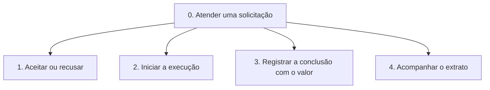

**Plano 0:** faça 1. Se recusou, a tarefa termina. Se aceitou, combine o serviço pelo
contato liberado e, no dia, faça 2. Ao terminar o serviço, faça 3. Se o cliente
contestar (status `CONTESTADA`), resolva a divergência com ele e faça 3 de novo. Faça 4
periodicamente.

### 1. Aceitar ou recusar

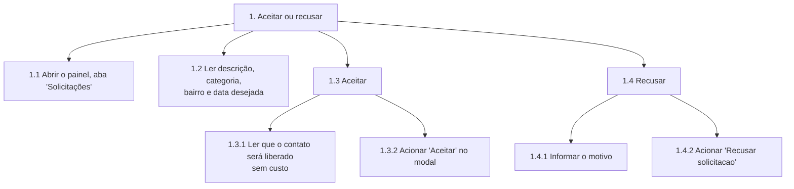

**Plano 1:** faça 1.1-1.2. Se puder atender, faça 1.3 (1.3.1-1.3.2); senão, faça 1.4
(1.4.1-1.4.2). Antes do aceite, o prestador não cancela: o caminho é recusar.

### 2. Iniciar a execução

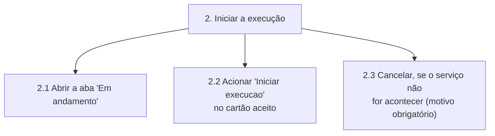

**Plano 2:** faça 2.1. No dia do serviço, faça 2.2. Se o serviço não for acontecer,
faça 2.3 em vez de 2.2 (só enquanto o status for `ACEITA`).

### 3. Registrar a conclusão com o valor

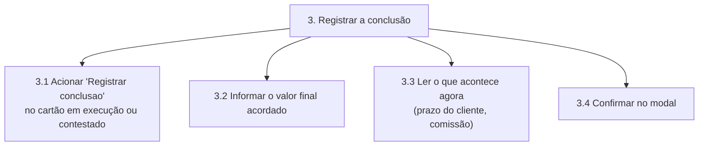

**Plano 3:** faça 3.1-3.2-3.3-3.4. Se o valor estiver vazio ou for zero, o sistema
avisa "Informe um valor maior que zero." e volta a 3.2. O status vai para
`AGUARDANDO_CONFIRMACAO`, e a comissão ainda não existe.

### 4. Acompanhar o extrato

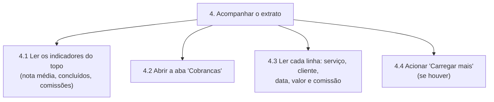

**Plano 4:** faça 4.1 a qualquer momento. Para o detalhe, faça 4.2-4.3. Faça 4.4 até
não haver mais linhas.

---

## Observações da análise

- **Tarefa 4 do cliente é a mais crítica**: concentra a regra de negócio (comissão,
  prazo, divergência) e depende de o cliente lembrar o valor que pagou. É a primeira
  candidata ao teste com usuários.
- **O prestador não é avisado** de uma nova solicitação: precisa abrir o painel (plano
  P1). As notificações já são gravadas, mas não aparecem na interface.
- **Tarefas 1 e 2 do cliente** cabem em quatro telas, com o indicador de etapas em
  `solicitar.html`.
