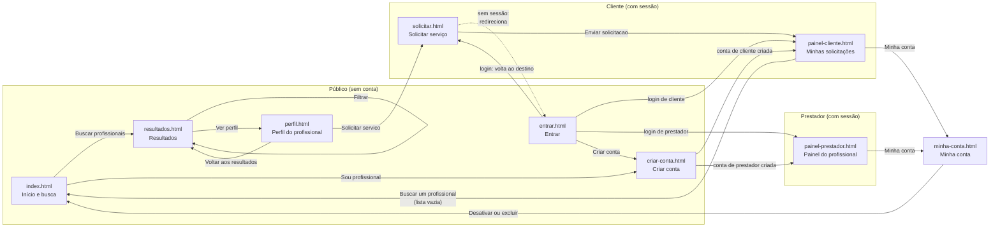

# Projeto de diálogo

O diálogo descreve a conversa entre o usuário e o sistema: para onde cada tela leva, o
que o usuário faz em cada ação e o que o sistema responde. Tudo aqui foi tirado do
código real (`src/main/resources/static/` e as mensagens da API). Os textos aparecem
como estão no sistema, inclusive sem acento quando é o caso.

## 1. Mapa de navegação

As nove telas reais e as transições entre elas. O cabeçalho (`UI.montarTopo`, em
`js/ui.js`) muda conforme a sessão: o visitante vê "Como funciona", "Entrar" e "Criar
conta"; quem entrou vê "Buscar profissional", "Meu painel", "Minha conta" e "Sair".

Regras de acesso (`UI.iniciarPagina`, em `js/ui.js`):

- `solicitar.html`, os painéis e `minha-conta.html` exigem sessão. Sem sessão, o sistema
  leva a `entrar.html?destino=…` e, depois do login, volta à página pedida. O destino só
  é aceito se for um caminho interno.
- Cada painel exige o perfil certo. Um prestador que abre `painel-cliente.html` (ou
  `solicitar.html`) é levado ao próprio painel, e vice-versa.
- Já logado, quem abre `entrar.html` ou `criar-conta.html` vai direto ao seu painel.

## 2. Botões que dependem do status (`acoesDisponiveis`)

A API devolve, em cada solicitação, a lista `acoesDisponiveis`, calculada em
`SolicitacaoMapper.acoes`. O front-end desenha só esses botões, sem recalcular a regra.

| Status | Cliente vê | Prestador vê |
|---|---|---|
| `SOLICITADA` | **Cancelar solicitacao** | **Aceitar** · **Recusar** |
| `ACEITA` | **Cancelar solicitacao** | **Cancelar** · **Iniciar execucao** |
| `EM_EXECUCAO` | (nenhum) | **Registrar conclusao** |
| `AGUARDANDO_CONFIRMACAO` | **Confirmar conclusao** (principal) · **Contestar** | (nenhum; vê o valor e o prazo do cliente) |
| `CONTESTADA` | (nenhum) | **Registrar conclusao** |
| `CONCLUIDA` | **Avaliar profissional** (se ainda não avaliou) | (nenhum) |
| `RECUSADA`, `CANCELADA` | (nenhum) | (nenhum) |

Hierarquia visual dos botões (`pagina-painel-cliente.js` e `pagina-painel-prestador.js`):
"Confirmar conclusao", "Aceitar" e "Registrar conclusao" usam `btn-primario` (verde);
"Contestar" e "Recusar" usam `btn-secundario` (contorno): peso menor, mas sempre
visíveis; os cancelamentos usam `btn-perigo` (vermelho).

Além dos botões, o cartão muda com o status:

- **contato**: telefone e e-mail aparecem a partir de `ACEITA` ("Contato liberado: …");
- **valor, para o cliente**: em `AGUARDANDO_CONFIRMACAO` e `CONTESTADA`, aparece "Valor:
  você informa ao confirmar"; em `CONCLUIDA`, "Valor do servico";
- **valor, para o prestador**: "Valor acordado" sempre que houver valor final;
- **destaque**: o cartão do cliente em `AGUARDANDO_CONFIRMACAO` e o do prestador em
  `CONTESTADA` ganham borda laranja (`cartao-destaque`).

## 3. Diálogo das ações principais

Formato: **Usuário** faz → **Sistema** responde. "Toast" é o aviso flutuante no rodapé
da tela (`UI.toast`); as mensagens de erro da API chegam pelo mesmo aviso (`UI.erro`).

### 3.1 Buscar (visitante, `index.html`)

| Usuário | Sistema |
|---|---|
| Abre a página inicial | Preenche categorias e cidades a partir de `/catalogo`; mostra o percentual de comissão vindo do servidor |
| Escolhe uma cidade | Restringe a lista de bairros àquela cidade |
| Aciona "Buscar profissionais" sem categoria | Toast de erro: "Escolha uma categoria para buscar." e foco no campo Categoria |
| Aciona "Buscar profissionais" com categoria | Vai a `resultados.html`, com "N profissionais encontrados em …"; profissionais sem nota em bloco separado |
| Nenhum profissional atende | "Nenhum profissional atende essa categoria nessa regiao ainda." |

### 3.2 Entrar (`entrar.html`)

| Usuário | Sistema |
|---|---|
| Aciona "Entrar" sem e-mail ou senha | Toast: "Informe e-mail e senha." |
| Envia credenciais erradas | Botão mostra "Entrando..." e depois toast: "E-mail ou senha incorretos." (a mesma mensagem para e-mail inexistente) |
| Erra a senha 5 vezes | "Conta bloqueada temporariamente. Tente novamente em alguns minutos." |
| Entra com sucesso | Vai ao destino pedido ou ao painel do seu perfil |

### 3.3 Solicitar serviço (cliente, `solicitar.html`)

| Usuário | Sistema |
|---|---|
| Abre a tela vinda do perfil | Mostra o indicador "1 Busca · 2 Resultados · 3 Perfil · 4 Solicitacao", o resumo do profissional e só as categorias e bairros que ele atende; data sugerida para daqui a 2 dias; endereço da conta já preenchido |
| Escolhe o bairro | Cidade e bairro do endereço são preenchidos sozinhos (somente leitura) |
| Envia sem descrição | Erro no campo: "Descreva o que voce precisa." |
| Envia sem rua ou número | Erro no campo Rua: "Informe o endereco onde o servico sera feito." |
| Envia o pedido válido | Botão "Enviando...", toast "Solicitacao enviada. O profissional vai responder em breve." e, em seguida, o painel do cliente |
| (Regra da API) categoria ou região fora da atuação | "Este profissional nao atende essa categoria nessa regiao." |

### 3.4 Aceitar ou recusar (prestador, `painel-prestador.html`)

| Usuário | Sistema |
|---|---|
| Aciona "Aceitar" | Modal "Aceitar solicitacao": "Ao aceitar, telefone e e-mail sao liberados para os dois lados, sem nenhum custo. A comissao so existe depois que o cliente confirmar a conclusao." |
| Confirma no modal | Toast: "Solicitacao aceita. Contatos liberados." O cartão passa para `ACEITA` |
| Aciona "Recusar" | Modal "Recusar solicitacao", com o campo "Motivo — obrigatorio" |
| Confirma sem motivo | Toast: "Informe o motivo." e o modal continua aberto |
| Confirma com motivo | Toast: "Solicitacao recusada." |

### 3.5 Iniciar e registrar a conclusão (prestador)

| Usuário | Sistema |
|---|---|
| Aciona "Iniciar execucao" | Sem modal; toast: "Execucao iniciada." O cartão explica: "Ao registrar a conclusao, o cliente tera 7 dias para confirmar. A comissao so e gerada na confirmacao." |
| Aciona "Registrar conclusao" | Modal com o campo "Valor final acordado" ("E sobre este valor que a comissao de 10% sera calculada.") e o aviso "O que acontece agora" |
| Confirma com valor vazio ou zero | Toast: "Informe um valor maior que zero." e o modal continua aberto |
| Confirma com valor válido | Toast: "Conclusao registrada. Aguardando a confirmacao do cliente." O cartão mostra "Valor acordado" e "Cliente tem ate … para confirmar" |

### 3.6 Confirmar informando o valor pago (cliente)

| Usuário | Sistema |
|---|---|
| Abre o painel com um serviço a confirmar | A aba "Aguardando voce" mostra um contador; o cartão aparece em destaque, com "Valor: você informa ao confirmar" e "Responda ate …" |
| Aciona "Confirmar conclusao" | Modal "Confirmar a conclusao do servico": serviço, profissional, data do registro, o campo vazio "Quanto você pagou pelo serviço?", os efeitos da confirmação (comissão de 10% sobre o valor do serviço) e o prazo. **Nenhum valor do profissional aparece** (confirmação às cegas) |
| Confirma sem valor ou com valor ≤ 0 | Toast: "Informe quanto voce pagou, com valor maior que zero." e foco volta ao campo |
| Informa o mesmo valor do profissional | Toast: "Servico confirmado. Comissao registrada ao profissional." O cartão passa a `CONCLUIDA`, mostra "Valor do servico" e o botão "Avaliar profissional" |
| Informa um valor diferente | Toast: "O valor informado e diferente do registrado pelo profissional. A conclusao voltou para ele revisar e nenhuma comissao foi cobrada." O cartão passa a `CONTESTADA`, com o motivo "Divergencia de valor: o valor informado pelo cliente (R$ X) nao confere com o registrado pelo profissional." |
| Não responde em 7 dias | O sistema confirma sozinho; o cartão informa "por decurso do prazo de 7 dias" |

### 3.7 Contestar (cliente)

| Usuário | Sistema |
|---|---|
| Aciona "Contestar" | Modal "Contestar a conclusao", com o campo "Motivo da contestacao — obrigatorio" e a lista "O que acontece ao contestar" (sem cobrança; a confirmação automática deixa de valer) |
| Envia sem motivo | Toast: "O motivo e obrigatorio para contestar." |
| Envia com motivo | Toast: "Contestacao enviada. Nenhuma cobranca foi gerada." O cartão passa a `CONTESTADA` |

### 3.8 Cancelar e avaliar (cliente)

| Usuário | Sistema |
|---|---|
| Aciona "Cancelar solicitacao" | Modal com "O cancelamento so e permitido enquanto o servico ainda nao comecou." e o motivo obrigatório; sem motivo: "Informe o motivo do cancelamento."; com motivo: "Solicitacao cancelada." |
| Aciona "Avaliar profissional" | Modal com nota de 1 a 5 (5 já marcada), comentário opcional e "A avaliacao e publica e unica para cada servico." Ao enviar: "Avaliacao enviada. Obrigado!" |

### 3.9 Erros transversais

| Situação | Resposta do sistema |
|---|---|
| A API não responde | Faixa fixa no topo: "Sem conexao com o servidor." com o botão "Tentar de novo" (`UI.montarFaixaSemConexao`) |
| Sessão expirada | Toast "Faca login para continuar." e, 1,2 s depois, `entrar.html` |
| Ação fora de ordem (outra pessoa mudou o status antes) | "Nao e possivel passar de CONCLUIDA para ACEITA." (`TransicaoInvalidaException`) |
| Duas ações ao mesmo tempo | "Este registro foi alterado por outra acao. Atualize a pagina e tente de novo." |
| Campos inválidos na API | "Verifique os campos informados." seguido da lista dos campos |

## 4. Pontos de atenção do diálogo

Registrados também em [heuristicas-nielsen.md](heuristicas-nielsen.md):

- os modais de ação fecham assim que o usuário confirma, antes da resposta da API; se a
  API recusar, o erro aparece num toast e o que foi digitado (motivo, valor) se perde;
- a mensagem de transição inválida mostra nomes internos de status (`CONCLUIDA`,
  `ACEITA`);
- "Iniciar execucao" não pede confirmação, ao contrário das outras ações;
- a resposta das ações e os erros aparecem só em toasts que somem depois de 4,2
  segundos.
