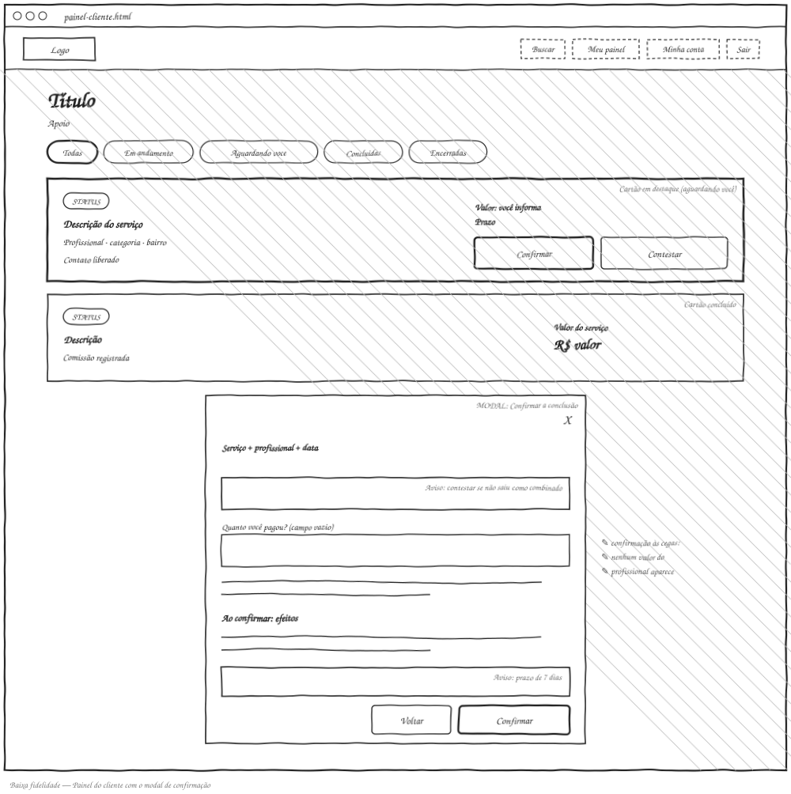
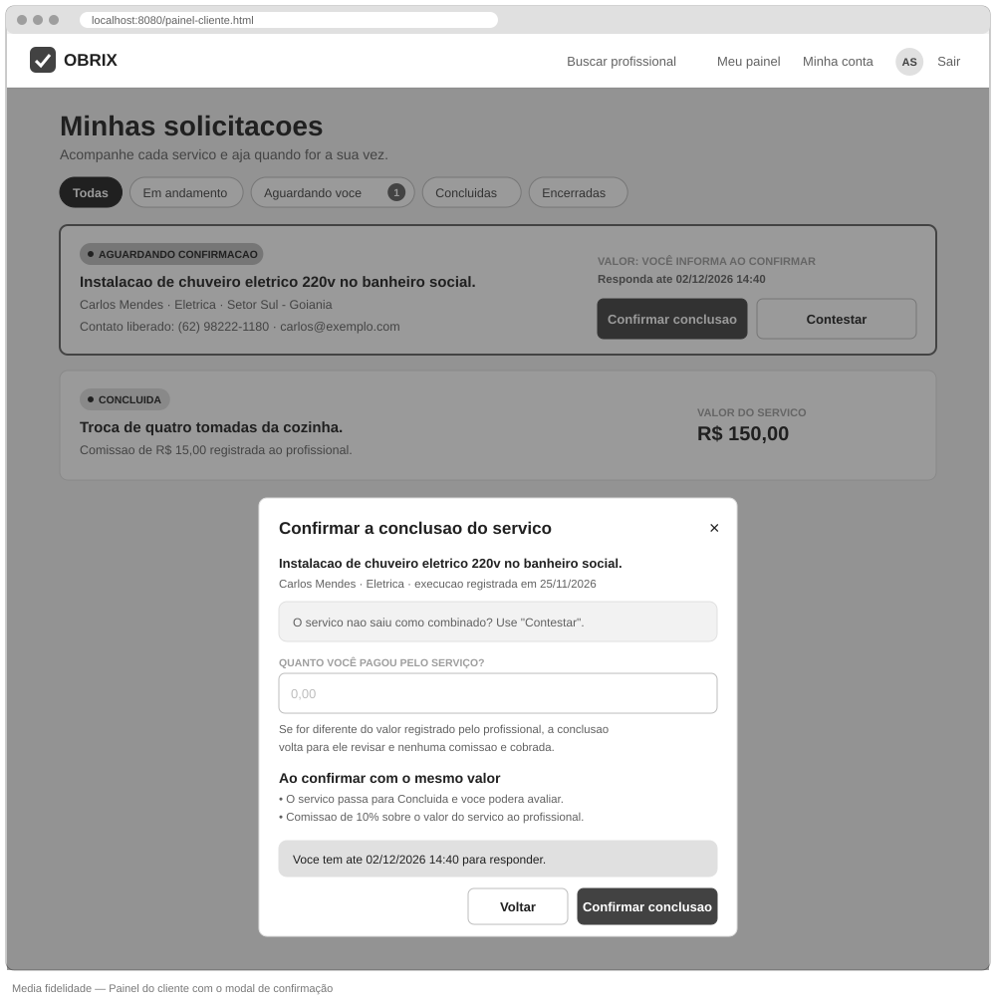
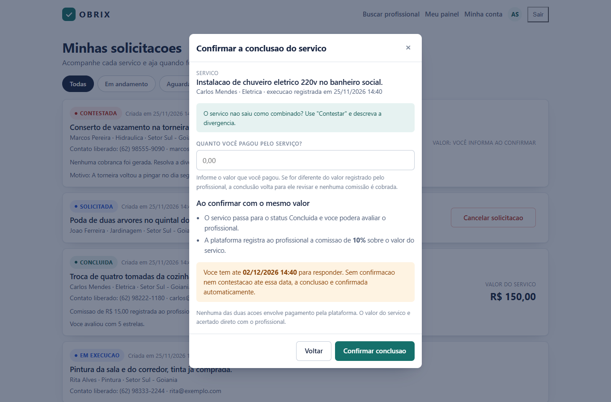

# Prototipação

O Obrix é documentado em três níveis de fidelidade, todos na pasta
[prototipos/](prototipos/).

## Origem dos protótipos (leia primeiro)

- Os mockups originais do projeto estão no documento do Projeto Integrador (PI), cujo
  guia de estilo deu origem ao `obrix.css` (Seção 8.7). **Eles ainda não estão neste
  repositório.** Serão anexados em [prototipos/originais/](prototipos/originais/) quando
  a equipe os enviar.
- Os wireframes de **baixa e média fidelidade** desta pasta **foram documentados agora**
  (25/11/2026), a partir do fluxo já implementado. Não são os artefatos que antecederam
  a implementação: representam o sistema atual nesses níveis de abstração, para análise
  e para os próximos ciclos de projeto.
- A **alta fidelidade** são capturas de tela do sistema real, rodando no perfil `dev`.

## Baixa fidelidade

**Pasta:** [prototipos/baixa-fidelidade/](prototipos/baixa-fidelidade/), em SVG.

**O que é:** esboço da estrutura de cada tela, com traço de rascunho, sem cor e sem
texto real. Só caixas, rótulos genéricos ("Título", "Categoria ▾", "Botão Buscar") e
linhas no lugar dos parágrafos. Serve para discutir **o que** está na tela e **onde**,
sem a distração do visual. As notas com ✎ marcam decisões de projeto.

| Tela | Arquivo |
|---|---|
| Início e busca | [01-inicio-busca.svg](prototipos/baixa-fidelidade/01-inicio-busca.svg) |
| Resultados | [02-resultados.svg](prototipos/baixa-fidelidade/02-resultados.svg) |
| Solicitar serviço | [03-solicitar.svg](prototipos/baixa-fidelidade/03-solicitar.svg) |
| Painel do cliente com o modal de confirmação | [04-painel-cliente-modal-confirmacao.svg](prototipos/baixa-fidelidade/04-painel-cliente-modal-confirmacao.svg) |
| Painel do prestador | [05-painel-prestador.svg](prototipos/baixa-fidelidade/05-painel-prestador.svg) |

## Média fidelidade

**Pasta:** [prototipos/media-fidelidade/](prototipos/media-fidelidade/), em SVG.

**O que é:** o layout real das telas em tons de cinza, com os textos reais do sistema e
os componentes (botões com a hierarquia primário, secundário e perigo, campos com
rótulo, cartões, selos de status, abas com contador). Ainda sem a paleta: a cor não
entra, para avaliar hierarquia e legibilidade só pelo contraste de tons.

| Tela | Arquivo |
|---|---|
| Início e busca | [01-inicio-busca.svg](prototipos/media-fidelidade/01-inicio-busca.svg) |
| Resultados | [02-resultados.svg](prototipos/media-fidelidade/02-resultados.svg) |
| Solicitar serviço | [03-solicitar.svg](prototipos/media-fidelidade/03-solicitar.svg) |
| Painel do cliente com o modal de confirmação | [04-painel-cliente-modal-confirmacao.svg](prototipos/media-fidelidade/04-painel-cliente-modal-confirmacao.svg) |
| Painel do prestador | [05-painel-prestador.svg](prototipos/media-fidelidade/05-painel-prestador.svg) |

Observações sobre o conteúdo:

- Os textos vêm do código e dos dados de demonstração (Ana, Carlos, o chuveiro de
  R$ 280,00). Onde os dados de demonstração não têm um caso para mostrar, o cartão traz
  "(exemplo)": o segundo profissional dos resultados e os cartões "Solicitada" e "Em
  execução" do painel do prestador.
- O painel do prestador reúne cartões de três status numa só vista para mostrar as
  variações. No sistema, cada aba filtra os seus status.
- O modal de confirmação segue a **confirmação às cegas**: nenhum valor do profissional
  aparece, e o cartão diz "Valor: você informa ao confirmar".

## Alta fidelidade

**Pasta:** [prototipos/alta-fidelidade/](prototipos/alta-fidelidade/), em PNG.

**O que é:** capturas de tela do sistema real, rodando localmente no perfil `dev` (H2
em memória, com os dados de demonstração recriados ao subir), em janela de 1366 × 900 px.
As capturas foram feitas em 25/11/2026 com o Chrome em modo headless, dirigido pelo
protocolo DevTools para entrar como Ana e como Carlos e para abrir o modal de
confirmação. Nenhuma ação que alterasse dados foi executada.

| # | Tela | Perfil | Arquivo |
|---|---|---|---|
| 01 | Início e busca | Visitante | [01-inicio-busca.png](prototipos/alta-fidelidade/01-inicio-busca.png) |
| 02 | Resultados (Elétrica) | Visitante | [02-resultados.png](prototipos/alta-fidelidade/02-resultados.png) |
| 03 | Perfil do profissional | Visitante | [03-perfil-prestador.png](prototipos/alta-fidelidade/03-perfil-prestador.png) |
| 04 | Solicitar serviço | Cliente | [04-solicitar.png](prototipos/alta-fidelidade/04-solicitar.png) |
| 05 | Entrar | Visitante | [05-entrar.png](prototipos/alta-fidelidade/05-entrar.png) |
| 06 | Criar conta | Visitante | [06-criar-conta.png](prototipos/alta-fidelidade/06-criar-conta.png) |
| 07 | Painel do cliente | Cliente | [07-painel-cliente.png](prototipos/alta-fidelidade/07-painel-cliente.png) |
| 08 | Modal de confirmação (às cegas) | Cliente | [08-modal-confirmacao.png](prototipos/alta-fidelidade/08-modal-confirmacao.png) |
| 09 | Minha conta | Cliente | [09-minha-conta.png](prototipos/alta-fidelidade/09-minha-conta.png) |
| 10 | Painel do prestador (aba Solicitações) | Prestador | [10-painel-prestador.png](prototipos/alta-fidelidade/10-painel-prestador.png) |
| 10b | Painel do prestador (aba Em andamento) | Prestador | [10b-painel-prestador-em-andamento.png](prototipos/alta-fidelidade/10b-painel-prestador-em-andamento.png) |
| 11 | Extrato de cobranças | Prestador | [11-extrato-prestador.png](prototipos/alta-fidelidade/11-extrato-prestador.png) |
| 12 | Painel do cliente em 683 px (equivale a 200% de zoom) | Cliente | [12-painel-cliente-683px-zoom-200.png](prototipos/alta-fidelidade/12-painel-cliente-683px-zoom-200.png) |

Para refazer as capturas: suba com `mvn spring-boot:run`, entre como
`ana@exemplo.com` ou `carlos@exemplo.com` (senha `obrix123`) e capture cada tela da
tabela em 1366 × 900 px.

## Evolução entre os níveis

| Decisão | Baixa | Média | Alta |
|---|---|---|---|
| Busca no topo da página inicial, sem exigir conta | Caixa "Formulário de busca" | Três listas e o botão com os textos reais | Busca sobre o fundo escuro, botão verde |
| O cartão que espera o cliente se destaca | Borda mais grossa | Borda escura | Borda laranja e o prazo "Responda até" |
| Confirmar tem mais peso que Contestar, mas os dois aparecem | Traço grosso × traço fino | Preenchido × contorno | Verde × contorno |
| Confirmação às cegas | Nota ✎ "nenhum valor do profissional aparece" | Campo vazio "0,00" e nenhum valor no modal | Igual ao sistema |
| Status nunca só pela cor | Selo com a palavra "STATUS" | Selo com o texto do status | Selo colorido e com o texto |
